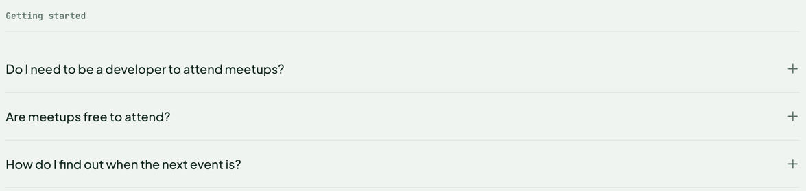

# Accordion

A group of expandable questions and answers, built on native `<details>` and `<summary>`. An optional mono label heads the group; `Accordion.Item` is each question.

**Status:** complete

## When to use

- FAQs and other content readers scan and open selectively.
- Not for primary content everyone needs; hidden text is easy to miss.

## Used in

Homepage "Common questions".



## Import

```tsx
import { Accordion } from '@/components/Accordion';
```

## Basic usage

```tsx
<Accordion label="Getting started">
  <Accordion.Item question="Do I need to be a developer to attend meetups?">
    <p>Not at all…</p>
  </Accordion.Item>
  <Accordion.Item question="Are meetups free to attend?" defaultOpen>
    <p>Almost always…</p>
  </Accordion.Item>
</Accordion>
```

## Props

`Accordion`:

| Prop | Type | Default | Description |
|---|---|---|---|
| `children` | `ReactNode` | — | `Accordion.Item` elements |
| `label` | `string` | — | Muted eyebrow over a rule |

`Accordion.Item`:

| Prop | Type | Default | Description |
|---|---|---|---|
| `question` | `string` | — | Summary text |
| `children` | `ReactNode` | — | Answer |
| `defaultOpen` | `boolean` | `false` | Open on first render |

## CSS classes

| Class | When applied |
|---|---|
| `wpc-accordion`, `wpc-accordion__label` | Group and label |
| `wpc-accordion__item`, `__question`, `__answer` | Each item |
| `wpc-accordion__icon--closed` / `--open` | The plus and minus icons, swapped by `[open]` |

## Design tokens

| Token | Used for |
|---|---|
| `--wpc--color-border` (role) | Label and item rules |
| `--wpc--color-heading`, `--wpc--color-text-muted` (roles) | Question, icon and answer |
| `--wpc--font-family-sans`, `--wpc--font-size-large`, `--wpc--line-height-relaxed` | Question |
| `--wpc--layout-small-size` | Answer max width |
| `--wpc--spacing-x-small` … `--wpc--spacing-medium` | Padding and gaps |

## Accessibility

- Native `<details>`: works without JavaScript, and the summary is keyboard-operable (Enter and Space) and announced as expanded or collapsed.
- The browser's marker is hidden; the plus and minus icons are decorative, as the expanded state is announced natively.
- The summary shows the global focus ring.
- Items open independently. Add the `name` attribute to the `<details>` if exclusive opening is ever needed.
