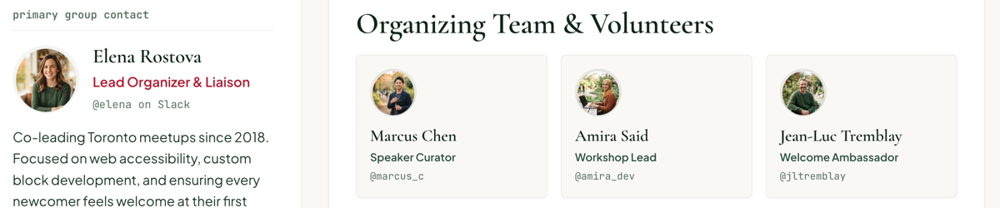
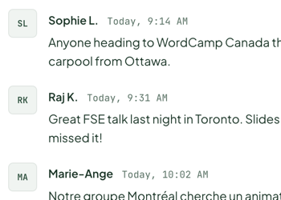

# Avatar

A person's photo in a ringed circle, or their initials in a tinted tile. Renders a `<span>`, holding a `next/image` when there's a photo.

**Status:** complete

## When to use

- Beside a person's name: the primary contact (large), the organizing team (medium), Slack messages (small square initials).
- Without `src` it shows initials, so it works before a photo exists.

## Used in

Group page primary contact and volunteers, homepage Slack chat preview.





## Import

```tsx
import { Avatar } from '@/components/Avatar';
```

## Basic usage

```tsx
<Avatar name="Elena Rostova" src="/people/elena.jpg" size="large" />
<Avatar name="Marcus Chen" src="/people/marcus.jpg" />
<Avatar name="Sophie L." size="small" shape="square" />
```

## Props

| Prop | Type | Default | Description |
|---|---|---|---|
| `name` | `string` | — | The person's name; used for the initials (required) |
| `src` | `string` | — | Photo URL; without it, initials show |
| `alt` | `string` | `''` | Accessible text; empty means decorative |
| `size` | `'small' \| 'medium' \| 'large'` | `'medium'` | 36px, 56px or 76px |
| `shape` | `'circle' \| 'square'` | `'circle'` | Square uses the small radius |

Other HTML attributes pass through.

Initials are the first letters of the first two words, split on spaces and hyphens: "Sophie L." → SL, "Marie-Ange" → MA.

## CSS classes

| Class | When applied |
|---|---|
| `wpc-avatar` | Always |
| `wpc-avatar--{size}`, `wpc-avatar--{shape}` | Always |
| `wpc-avatar--photo` / `wpc-avatar--initials` | With / without `src` |
| `wpc-avatar__image` | The photo |

## Design tokens

| Token | Used for |
|---|---|
| `--wpc--layout-avatar-small`, `-medium`, `-large` | Sizes (also passed to the image `sizes` hint through `wpcTokens.layout`) |
| `--wpc--radius-full`, `--wpc--radius-sm` | Circle and square |
| `--wpc--color-white`, `--wpc--color-border` (role) | Photo ring and outline |
| `--wpc--color-surface-tint` | Photo placeholder and initials background |
| `--wpc--font-family-mono`, `--wpc--font-size-x-small`, `--wpc--font-weight-medium`, `--wpc--line-height-flat` | Initials |
| `--wpc--color-moss`, `--wpc--color-sage-dark` | Initials text and border |

The photo ring is a 2px border with a 1px outline: structural widths, like the 1px borders elsewhere.

## Accessibility

- Decorative by default (`alt=""`), because every avatar in the designs sits next to the person's name; announcing both would repeat it. Initials get `aria-hidden` for the same reason.
- When an avatar stands alone, pass `alt` (e.g. the person's name): photos use it as alt text, and initials become `role="img"` with that label.
- Moss on the sage tile is about 9:1.

## Open questions

- Remote photos (Gravatar, WordPress profiles) need their hosts added to `images.remotePatterns` in `next.config.ts` once a data source is chosen.
