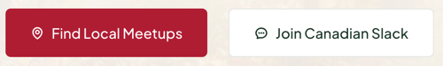

# Button

An action trigger that renders a native `<button>`, or a link styled as a button when an `href` is provided. Comes in three colour variants, an optional leading icon, and size, width and disabled states.

**Status:** complete

## When to use

- Trigger an in-page action: submitting a form, opening a dialog, starting a process.
- Pass `href` for a call to action that should look like a button, such as "Find Local Meetups" or "RSVP on Meetup.com". It renders through [`Link`](../../src/components/LinkProvider/), so the app's router handles it.
- Don't use it for links inside running text; a plain link reads as part of the sentence.
- Wrap two or more buttons side by side in a [`ButtonGroup`](./button-group.md) rather than managing spacing by hand.

## Used in

Homepage hero ("Find Local Meetups", "Join Canadian Slack"), Slack section ("Get your invite"), "Start a group" form ("Submit my group"), group page contact card ("Contact Organizer", "Find on Slack"), Upcoming Gathering band ("RSVP on Meetup.com", "Propose a Talk").



## Import

```tsx
import { Button } from '@/components/Button';
```

## Basic usage

```tsx
// Action
<Button text="Submit my group" type="submit" />

// Call to action link
<Button text="Find Local Meetups" href="/meetups" />

// White, the quieter choice on a light surface
<Button text="Join Canadian Slack" color="white" href="/slack" />

// Solid forest
<Button text="Contact Organizer" color="forest" href="/contact" />

// Outline, on a dark (forest or crimson) surface
<Button text="Propose a Talk" color="inverse" href="/talks" />

// Hero: large, with a leading icon
<Button text="Find Local Meetups" icon="map-pin" href="/meetups" isLarge />
```

## Props

| Prop | Type | Default | Description |
|---|---|---|---|
| `text` | `string` | — | Button label and accessible name (required) |
| `color` | `'crimson' \| 'white' \| 'forest' \| 'inverse'` | `'crimson'` | A surface from the shared set (the names `Container` and `Card` use), or `inverse`, the outline for dark sections |
| `href` | `string` | — | Renders a `Link` instead of a `<button>` |
| `type` | `'button' \| 'submit' \| 'reset'` | `'button'` | Button type (button form only) |
| `icon` | `IconName` | — | Leading [`Icon`](./icon.md) |
| `rounded` | `'none' \| 'sm' \| 'md' \| 'lg' \| 'full'` | `'sm'` | Corner radius |
| `isSmall` | `boolean` | `false` | Smaller padding and font size |
| `isLarge` | `boolean` | `false` | Hero size: about 55px tall, `font-size-large` |
| `isFull` | `boolean` | `false` | Full width |
| `disabled` | `boolean` | `false` | Native disabled state (button form only) |

Any other `<button>` or `Link` props pass through.

## CSS classes

| Class | When applied |
|---|---|
| `wpc-button` | Always |
| `wpc-button--{color}` | The active `color`, unless disabled |
| `wpc-button--disabled` | `disabled` |
| `wpc-button--radius-{name}` | The active `rounded` value |
| `wpc-button--small` | `isSmall` |
| `wpc-button--large` | `isLarge` |
| `wpc-button--full` | `isFull` |

The variants read palette tokens (crimson, forest, white…) rather than role tokens, so a button looks the same in every section tone.

## Design tokens

| Token | Used for |
|---|---|
| `--wpc-surface-fill`, `--wpc-surface-text`, `--wpc-surface-hover-fill` | Crimson and forest: fill and border, label, and the darker fill on hover (`crimson-700`, `forest-900`) |
| `--wpc-surface-fill`, `--wpc-surface-text`, `--wpc-surface-border`, `--wpc-surface-hover-border` | White: fill, `forest-950` label, `stone-200` border, `sage-600` border on hover |
| `--wpc--color-white` (mixed with transparent) | Inverse text, border and hover background |
| The sage surface, `--wpc--color-sage-600` | Disabled background and border, and text |
| `--wpc--font-family-sans`, `--wpc--font-size-medium`, `--wpc--font-weight-medium`, `--wpc--line-height-relaxed` | Typography (about 44px tall) |
| `--wpc--font-size-small` | Small variant |
| `--wpc--font-size-large`, `--wpc--line-height-tight`, `--wpc--spacing-medium` | Large variant |
| `--wpc--spacing-x-small`, `--wpc--spacing-small`, `--wpc--spacing-2x-small` | Padding and icon gap |
| `--wpc--radius-*` | Corner radius |
| `--wpc--transition-fast` | Hover transition |

## Accessibility

- Without `href` it's a native `<button>`: focusable, activated with Enter or Space, and announced as a button. It defaults to `type="button"` so it won't submit a surrounding form unless you pass `type="submit"`.
- With `href` it's a link: announced as a link and activated with Enter only. Use links for navigation and buttons for actions.
- `text` is the accessible name. If several buttons share a label ("Read more"), pass an `aria-label` that starts with the visible text.
- `disabled` uses the native attribute, which removes the button from the tab order.
- Colour signals emphasis, not meaning; the text must say what the button does.
- White on crimson is about 6.8:1 and forest on white about 16:1.
- The icon is decorative; the text names the action.
