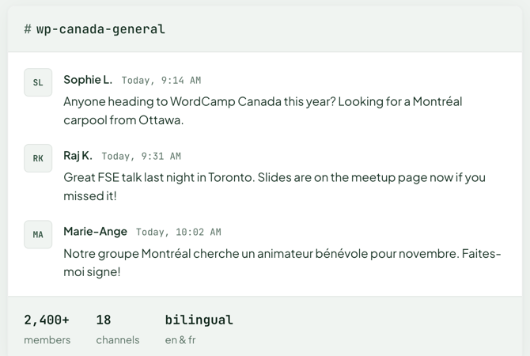

# ChatPreview

A static preview of a Slack channel: a channel header, a few messages and a stats footer. Renders a `<figure>` holding a bordered [`Card`](./card.md).

**Status:** complete

## When to use

- Showing what the community's Slack is like, beside an invite call to action.
- It's a picture of a conversation, not a live feed.

## Used in

Homepage "Join the WP Canada Slack".



## Import

```tsx
import { ChatPreview } from '@/components/ChatPreview';
```

## Basic usage

```tsx
<ChatPreview
  channel="wp-canada-general"
  messages={[
    { author: 'Sophie L.', time: 'Today, 9:14 AM', text: 'Anyone heading to WordCamp Canada this year?' },
  ]}
  stats={[
    { value: '2,400+', label: 'members' },
    { value: '18', label: 'channels' },
  ]}
/>
```

## Props

| Prop | Type | Default | Description |
|---|---|---|---|
| `channel` | `string` | — | Channel name, without the `#` |
| `messages` | `{ author: string; time: string; text: string }[]` | — | Messages in order |
| `stats` | `{ value: string; label: string }[]` | — | Footer stats ([`StatGroup`](./stat-group.md) `mono`) |
| `className` | `string` | — | Extra classes on the figure |

## CSS classes

| Class | When applied |
|---|---|
| `wpc-chat-preview` | The figure |
| `wpc-chat-preview__card`, `__channel`, `__hash`, `__messages`, `__message`, `__body`, `__meta`, `__author`, `__text`, `__footer` | Parts |

## Design tokens

| Token | Used for |
|---|---|
| `--wpc--color-surface-tint` | Header and footer bands |
| `--wpc--color-border`, `--wpc--color-heading`, `--wpc--color-text-muted` (roles) | Band rules, channel and author, the hash |
| `--wpc--font-family-mono`, `--wpc--font-size-medium`, `--wpc--font-weight-medium` | Channel name |
| `--wpc--font-weight-semibold` | Author |
| `--wpc--spacing-x-small` … `--wpc--spacing-medium` | Padding and gaps |

Avatars are small square initials ([`Avatar`](./avatar.md)); times are muted [`Eyebrow`](./eyebrow.md)s.

## Accessibility

- A `<figure>` labelled "Preview of the #channel Slack channel", with the messages as an ordered list.
- The `#` is decorative (`aria-hidden`), and the initials avatars are hidden because each author's name follows.
