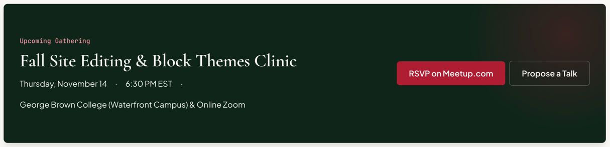

# CTABand

A dark call-to-action band for an upcoming event: an eyebrow, a title, date and time details, a location and buttons. Renders an inverse [`Card`](./card.md) as a `<section>`, with a crimson glow and a raised shadow.

**Status:** complete

## When to use

- Highlighting the next gathering on a group page.
- One per page; for full-width dark sections without the boxed look, use a [`Container`](./container.md) with `color="inverse"`.

## Used in

Group page "Upcoming Gathering".



## Import

```tsx
import { CTABand } from '@/components/CTABand';
```

## Basic usage

```tsx
<CTABand
  eyebrow="Upcoming Gathering"
  title="Fall Site Editing & Block Themes Clinic"
  details={['Thursday, November 14', '6:30 PM EST']}
  location="George Brown College (Waterfront Campus) & Online Zoom"
  actions={
    <ButtonGroup>
      <Button text="RSVP on Meetup.com" href="https://meetup.com/…" />
      <Button text="Propose a Talk" color="inverse" href="/talks" />
    </ButtonGroup>
  }
/>
```

## Props

| Prop | Type | Default | Description |
|---|---|---|---|
| `eyebrow` | `string` | — | Accent eyebrow |
| `title` | `string` | — | Heading text |
| `details` | `string[]` | — | Joined by middle dots |
| `location` | `ReactNode` | — | Line under the details |
| `actions` | `ReactNode` | — | Usually a ButtonGroup (primary + inverse) |
| `headingLevel` | `2 \| 3` | `2` | Title element |
| `className` | `string` | — | Extra classes |

## CSS classes

| Class | When applied |
|---|---|
| `wpc-cta-band` | Always (on the Card root) |
| `wpc-cta-band__content`, `__details`, `__separator`, `__location`, `__actions` | Parts |

## Design tokens

| Token | Used for |
|---|---|
| `--wpc--gradient-forest-glow` | The crimson glow, top right |
| `--wpc--shadow-raised` | Shadow |
| `--wpc--color-text-muted` (role) | Separators |
| `--wpc--spacing-x-small` … `--wpc--spacing-large` | Gaps |

The Card supplies the forest background, `md` radius, padding and the inverse roles: white heading, mist text, rose eyebrow.

## Responsive behaviour

The content and actions sit in one row when there's room and wrap, with the actions below, on narrow screens.

## Accessibility

- A `<section>` with a heading.
- The middle-dot separators are `aria-hidden`.
- On forest, the rose eyebrow is about 8:1 and mist text about 14:1.
