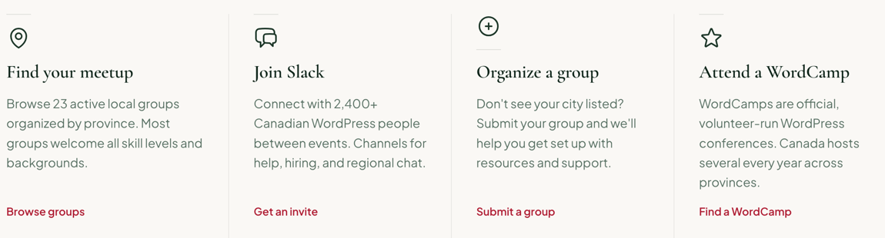

# FeatureItem

A short feature or next step: a small rule, an icon, a title, a sentence and a link. Renders a `<div>`.

**Status:** complete

## When to use

- A row of entry points such as "New here? Start with these.", in a [`GridGroup`](./grid-group.md) with `columns={4}` and `dividers="columns"`.
- Not for content with an image or a surface; use a [`Card`](./card.md).

## Used in

Homepage "New here? Start with these."



## Import

```tsx
import { FeatureItem } from '@/components/FeatureItem';
```

## Basic usage

```tsx
<GridGroup columns={4} dividers="columns">
  <FeatureItem icon="map-pin" title="Find your meetup" href="/groups" linkText="Browse groups">
    Browse 23 active local groups organized by province.
  </FeatureItem>
</GridGroup>
```

## Props

| Prop | Type | Default | Description |
|---|---|---|---|
| `icon` | `IconName` | — | Registry icon |
| `title` | `string` | — | Heading text |
| `children` | `ReactNode` | — | Description |
| `href` | `string` | — | Link destination |
| `linkText` | `string` | — | Link text |
| `headingLevel` | `2 \| 3 \| 4` | `3` | Title element |

## CSS classes

| Class | When applied |
|---|---|
| `wpc-feature-item` | Always (its `::before` is the short rule) |
| `wpc-feature-item__icon`, `__text`, `__link` | Icon, description, link |

## Design tokens

| Token | Used for |
|---|---|
| `--wpc--color-border` (role), `--wpc--spacing-medium` | The short rule and its width |
| `--wpc--color-heading` (role) | Icon colour |
| `--wpc--color-text-muted` (role) | Description |
| `--wpc--spacing-small` | Gaps |

The icon uses `heading-small` from the type scale (about 28px).

## Responsive behaviour

The item fills its grid cell, and the link is pinned to the bottom so links line up across a row.

## Accessibility

- The icon is decorative; the title and text carry the meaning.
- Link texts in a row are distinct ("Browse groups", "Get an invite"…), so they need no extra label.
