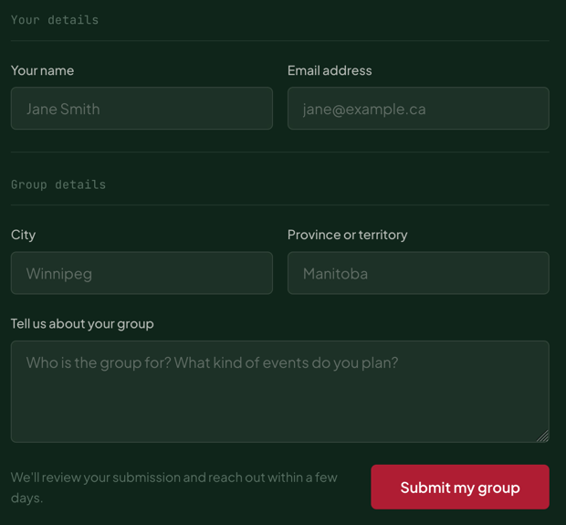

# Fieldset

Groups related form fields under a mono legend with a rule beneath it. Renders a native `<fieldset>` and `<legend>`.

**Status:** complete

## When to use

- Splitting a form into labelled sections ("Your details", "Group details").
- Not needed for a single field.

## Used in

Homepage "Start a group in your city" form.



## Import

```tsx
import { Fieldset } from '@/components/Fieldset';
```

## Basic usage

```tsx
<Fieldset legend="Your details">
  <GridGroup columns={2}>
    <TextField label="Your name" name="name" autoComplete="name" />
    <TextField label="Email address" name="email" type="email" autoComplete="email" />
  </GridGroup>
</Fieldset>
```

## Props

| Prop | Type | Default | Description |
|---|---|---|---|
| `legend` | `string` | — | Group label |
| `children` | `ReactNode` | — | Fields |

Other `<fieldset>` attributes (`disabled`…) pass through.

## CSS classes

| Class | When applied |
|---|---|
| `wpc-fieldset` | Always |
| `wpc-fieldset__legend`, `__body` | Legend and the field area |

## Design tokens

| Token | Used for |
|---|---|
| `--wpc--font-family-mono`, `--wpc--font-size-x-small`, `--wpc--line-height-snug` | Legend |
| `--wpc--color-text-muted`, `--wpc--color-border` (roles) | Legend text and rule |
| `--wpc--spacing-x-small`, `--wpc--spacing-medium` | Legend padding, gaps between children |

## Accessibility

- A native fieldset: screen readers announce the legend when focus enters the group.
- The legend is floated so it can lay out as a full-width block with its rule; that doesn't change its semantics.
- The body uses block flow, so layout children such as a two-column [`GridGroup`](./grid-group.md) keep their full width.
