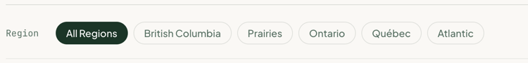

# FilterBar

A labelled row of [`FilterPill`](./filter-pill.md) toggles for single-choice filtering, with a rule beneath. A controlled client component: the parent owns the selected value.

**Status:** complete

## When to use

- Filtering a list by one dimension, such as region.
- With a [`SearchField`](./search-field.md) when people also need free text.

## Used in

Homepage "Local Meetup Groups".



## Import

```tsx
import { FilterBar } from '@/components/FilterBar';
```

## Basic usage

```tsx
'use client';

const [region, setRegion] = useState('all');
const visible = groups.filter((group) => region === 'all' || group.region === region);

<FilterBar label="Region" options={regions} value={region} onChange={setRegion} />
<GridGroup columns={3} dividers="all">{/* visible groups */}</GridGroup>
<Eyebrow aria-live="polite">Showing {visible.length} of {groups.length} groups</Eyebrow>
```

A divided [`GridGroup`](./grid-group.md) placed straight after the bar butts against its bottom rule, which then doubles as the grid's top line, so the column lines run up to it (the group directory). Any other element after the bar keeps the usual block gap.

The **Filtering A List** story (`FilterBar.stories.tsx`) is a working example, combined with a SearchField. The pages use `src/features/directory/`, where `DirectoryProvider` shares the query and region between the hero search and the group grid.

## Props

| Prop | Type | Default | Description |
|---|---|---|---|
| `label` | `string` | — | Visible label and the group's accessible name |
| `options` | `{ value: string; label: string }[]` | — | Choices |
| `value` | `string` | — | Selected option |
| `onChange` | `(value: string) => void` | — | Called with the clicked option's value |

## CSS classes

| Class | When applied |
|---|---|
| `wpc-filter-bar` | Always |
| `wpc-filter-bar__label` | The visible label |

## Design tokens

| Token | Used for |
|---|---|
| `--wpc--color-border` (role) | Bottom rule |
| `--wpc--spacing-x-small`, `--wpc--spacing-small` | Gaps and padding |

## Responsive behaviour

Pills wrap onto further lines on small screens.

## Accessibility

- `role="group"` named by `label`; the visible label is `aria-hidden` to avoid reading it twice.
- Each pill is a `<button aria-pressed>`, so the selected one is announced as pressed.
- It's a client component (`'use client'`) because it takes an event handler; render it inside a client wrapper that owns the state.
- Put the result count in a live region (`aria-live="polite"`) so changes are announced.
