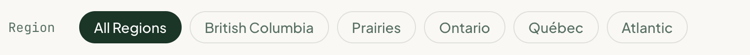

# FilterPill

A rounded toggle button for filtering a list, such as the region filter above the meetup groups. Renders a `<button aria-pressed>`. Stateless: the parent decides which pill is pressed.

**Status:** complete

## When to use

- One option in a filter row. The planned FilterBar groups them and owns the selection.
- Not for navigation (use a link) or for static labels ([`Pill`](./pill.md)).

## Used in

Homepage "Local Meetup Groups" region filter.



## Import

```tsx
import { FilterPill } from '@/components/FilterPill';
```

## Basic usage

```tsx
// Inside a client component that holds the selection
<FilterPill pressed={region === 'all'} onClick={() => setRegion('all')}>
  All Regions
</FilterPill>
```

## Props

| Prop | Type | Default | Description |
|---|---|---|---|
| `children` | `ReactNode` | — | Label |
| `pressed` | `boolean` | `false` | Selected state; sets `aria-pressed` |

Other `<button>` props pass through (`onClick`, `disabled`…). `type` is always `button`.

## CSS classes

| Class | When applied |
|---|---|
| `wpc-filter-pill` | Always |
| `wpc-filter-pill--pressed` | `pressed` |

## Design tokens

| Token | Used for |
|---|---|
| `--wpc--font-family-sans`, `--wpc--font-size-medium`, `--wpc--font-weight-normal`, `--wpc--line-height-flat` | Typography |
| `--wpc--color-text-muted`, `--wpc--color-text`, `--wpc--color-border` (roles) | Inactive text, hover text, border |
| `--wpc--color-forest-900`, `--wpc--color-white` | Pressed background and text |
| `--wpc--spacing-x-small`, `--wpc--spacing-small`, `--wpc--radius-full` | Padding and shape |
| `--wpc--transition-fast` | State transitions |

## Accessibility

- A native `<button>` with `aria-pressed`, so screen readers announce it as a toggle that's pressed or not.
- The pressed state changes the fill as well as the text colour, so it doesn't rely on hue alone.
- The global focus ring shows on keyboard focus.
- The FilterBar that groups these should label the group, e.g. `role="group"` with `aria-label="Filter by region"`, and announce result changes (e.g. "Showing 6 of 23 groups") in a live region.
