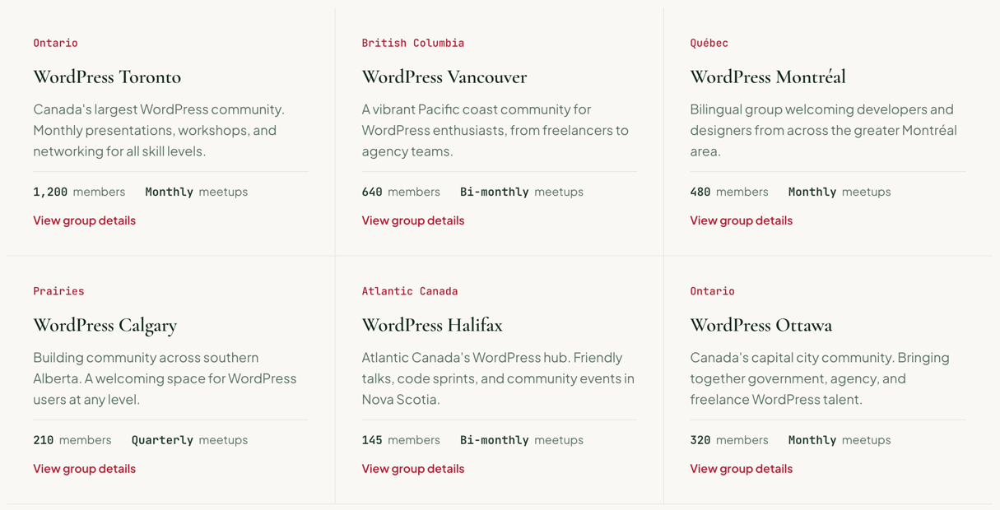

# GroupCard

One meetup group in the homepage grid: region, name, description, member count, cadence and a link to the group. Renders an unboxed `<article>`.

**Status:** complete

## When to use

- In the "Local Meetup Groups" grid, inside a [`GridGroup`](./grid-group.md) with `dividers="all"`, which draws the lines between cards.
- Not boxed: for a card on its own surface, compose a [`Card`](./card.md) instead.

## Used in

Homepage "Local Meetup Groups".



## Import

```tsx
import { GroupCard } from '@/components/GroupCard';
```

## Basic usage

```tsx
<GridGroup columns={3} dividers="all">
  <GroupCard
    region="Ontario"
    name="WordPress Toronto"
    description="Canada's largest WordPress community…"
    members={1200}
    cadence="Monthly"
    href="/groups/toronto"
  />
</GridGroup>
```

## Props

| Prop | Type | Default | Description |
|---|---|---|---|
| `region` | `string` | — | Accent eyebrow |
| `name` | `string` | — | Title |
| `description` | `string` | — | Muted paragraph |
| `members` | `string \| number` | — | Numbers are formatted for `locale` (1200 → 1,200, or 1 200 in French) |
| `cadence` | `string` | — | "Monthly", "Bi-monthly", "Quarterly" |
| `href` | `string` | — | Group page |
| `linkText` | `string` | `'View group details'` | Link text |
| `membersFormat` | `string` | `'{members} members'` | Meta template; `{members}` becomes the mono value |
| `cadenceFormat` | `string` | `'{cadence} meetups'` | Meta template, so word order can change by language (`'Rencontres {cadence}'`) |
| `locale` | `string` | `'en-CA'` | BCP 47 tag for number formatting |
| `headingLevel` | `2 \| 3 \| 4` | `3` | Title element |

Other HTML attributes pass through to the `<article>`.

## CSS classes

| Class | When applied |
|---|---|
| `wpc-group-card` | Always |
| `wpc-group-card__description`, `__meta`, `__value` | Description, meta line, mono values |

The region is an accent [`Eyebrow`](./eyebrow.md), the title a [`Heading`](./heading.md) (`x-large`), the link a [`TextLink`](./text-link.md).

## Design tokens

| Token | Used for |
|---|---|
| `--wpc--color-text-muted`, `--wpc--color-heading`, `--wpc--color-border` (roles) | Description and meta text, values, meta rule |
| `--wpc--font-family-mono`, `--wpc--font-weight-medium`, `--wpc--font-size-small` | Meta line |
| `--wpc--spacing-x-small`, `--wpc--spacing-small`, `--wpc--spacing-medium` | Gaps and meta padding |

## Responsive behaviour

The card fills its grid cell; the meta line sits at the bottom (`margin-top: auto`), so it lines up across a row.

## Accessibility

- An `<article>` with a heading, so each group is a navigable unit.
- Every card has the same link text, so the link carries `aria-label="{linkText}, {name}"` to tell them apart.
