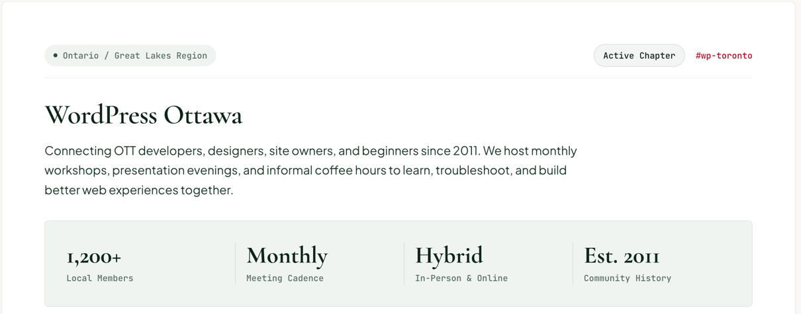

# GroupHeader

The top of a group page: region and status pills with the group's Slack channel, the page h1, a description and a stats panel. Renders a white [`Card`](./card.md) as a `<header>`.

**Status:** complete

## When to use

- Once, at the top of each group page.

## Used in

Group page.



## Import

```tsx
import { GroupHeader } from '@/components/GroupHeader';
```

## Basic usage

```tsx
<GroupHeader
  region="Ontario / Great Lakes Region"
  status="Active Chapter"
  channel={{ label: '#wp-ottawa', href: '/slack' }}
  title="WordPress Ottawa"
  description="Connecting Ottawa developers, designers, site owners, and beginners since 2011…"
  stats={[
    { value: '1,200+', label: 'Local Members' },
    { value: 'Monthly', label: 'Meeting Cadence' },
  ]}
/>
```

## Props

| Prop | Type | Default | Description |
|---|---|---|---|
| `region` | `string` | — | Region [`Pill`](./pill.md) |
| `status` | `string` | — | Status Pill |
| `channel` | `{ label: string; href: string }` | — | Mono [`TextLink`](./text-link.md) |
| `title` | `string` | — | The page h1 |
| `description` | `ReactNode` | — | Paragraph under the title |
| `stats` | `{ value: string; label: string }[]` | — | [`StatGroup`](./stat-group.md) in a tint Card |
| `className` | `string` | — | Extra classes |

## CSS classes

| Class | When applied |
|---|---|
| `wpc-group-header` | Always (on the Card root) |
| `wpc-group-header__bar`, `__description` | The pills row and the description |

## Design tokens

| Token | Used for |
|---|---|
| `--wpc--color-border` (role) | Rule under the pills row |
| `--wpc--font-size-large`, `--wpc--layout-small-size` | Description size and measure |
| `--wpc--spacing-small`, `--wpc--spacing-medium` | Gaps |

The Card gives the white surface, shadow and `large` padding; the title is a [`Heading`](./heading.md) at `heading-large` (48px).

## Accessibility

- A `<header>` inside `<main>` is a plain grouping element, not a banner landmark.
- The title is the page's only h1. It uses `heading-large`, so it stays larger than the 40px section titles below it, a deliberate change from the mockup's ~32px.
