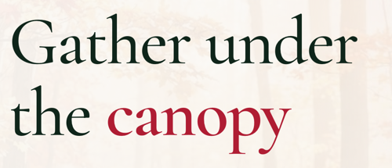

# Heading

A serif heading whose HTML level and visual size are set separately, with an optional accent word. Renders an `<h2>` by default, or the element set by `as`.

**Status:** complete

## When to use

- Any heading that needs a size other than its level's default: the hero display title, card titles, stat values.
- Use `accent` to colour one word, as in "Gather under the **canopy**".
- Plain `<h2>`–`<h6>` elements already get the base heading styles; reach for `Heading` when you need `size`, `accent` or a `p` styled as a heading.
- Section titles with meta text belong in [`SectionHeader`](./section-header.md).

## Used in

Homepage hero ("Gather under the canopy"), group page title, card titles, stat values, feature titles, update titles.



## Import

```tsx
import { Heading } from '@/components/Heading';
```

## Basic usage

```tsx
<Heading as="h1" size="display" accent="canopy">
  Gather under the canopy
</Heading>

// A card title: an h3 that looks smaller
<Heading as="h3" size="x-large">WordPress Toronto</Heading>

// A stat value that isn't a heading
<Heading as="p" size="heading-medium">1,200+</Heading>
```

## Props

| Prop | Type | Default | Description |
|---|---|---|---|
| `children` | `ReactNode` | — | Heading text |
| `as` | `'h1' \| 'h2' \| 'h3' \| 'h4' \| 'h5' \| 'h6' \| 'p'` | `'h2'` | Element |
| `size` | `'display' \| 'heading-large' \| 'heading-medium' \| 'heading-small' \| '2x-large' \| 'x-large' \| 'large'` | — | Visual size; without it the element's base heading size applies |
| `accent` | `string` | — | Part of a string `children` to show in the accent colour |

Other HTML attributes pass through.

## CSS classes

| Class | When applied |
|---|---|
| `wpc-heading` | Always |
| `wpc-heading--{size}` | `size` is set |
| `wpc-heading__accent` | Wraps the `accent` match |

## Design tokens

| Token | Used for |
|---|---|
| `--wpc--font-family-serif`, `--wpc--font-weight-medium`, `--wpc--line-height-tight` | Base heading look (lines are balanced with `text-wrap: balance`) |
| `--wpc--color-heading` (role) | Colour: forest on light, white on inverse |
| `--wpc--color-accent` (role) | Accent word: crimson on light, the light accent on inverse |
| `--wpc--font-size-display` … `--wpc--font-size-large` | Size modifiers |
| `--wpc--line-height-flat` | Display line height |

The display size also tightens letter spacing by `-0.02em`, a relative value rather than a token.

## Responsive behaviour

Every size is a fluid `clamp()`; the display heading runs from 44px on phones to 90px at 1280px.

## Accessibility

- Choose `as` for the document outline and `size` for the look. Keep one `h1` per page and don't skip levels.
- `accent` wraps part of the text in a `<span>` without changing the text, so it's announced as written.
- The accent colour is decoration; don't rely on it to convey meaning.
