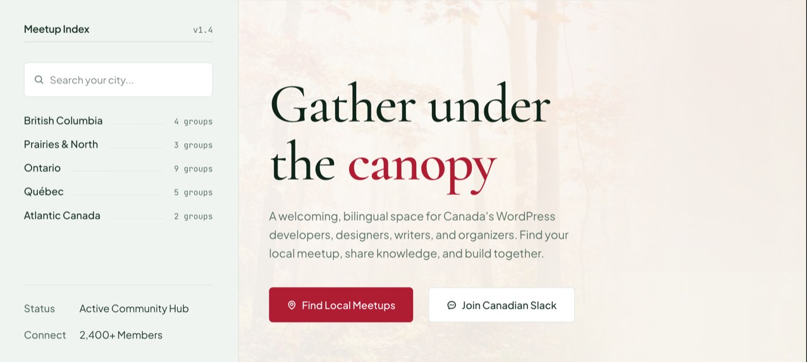

# Hero

The homepage's opening band: the display h1 with an accent word, a lead, call-to-action buttons, an optional sidebar and an optional background photo. Renders a full-bleed `<section>`.

**Status:** complete

## When to use

- Once, at the top of the homepage, with the [`MeetupIndex`](./meetup-index.md) in `aside`.
- Inside `<Main hasPadding={false}>`, so it meets the header.

## Used in

Homepage.



## Import

```tsx
import { Hero } from '@/components/Hero';
```

## Basic usage

```tsx
<Hero
  title="Gather under the canopy"
  accent="canopy"
  lead="A welcoming, bilingual space for Canada's WordPress developers, designers, writers, and organizers."
  actions={
    <ButtonGroup>
      <Button text="Find Local Meetups" icon="map-pin" href="#groups" isLarge />
      <Button text="Join Canadian Slack" icon="message-circle-more" color="secondary" href="#slack" isLarge />
    </ButtonGroup>
  }
  aside={<MeetupIndex regions={regions} />}
  image={{ src: '/images/hero-canopy.jpg' }}
/>
```

## Props

| Prop | Type | Default | Description |
|---|---|---|---|
| `title` | `string` | — | The page h1 |
| `accent` | `string` | — | Part of the title shown in the accent colour |
| `lead` | `ReactNode` | — | Paragraph under the title |
| `actions` | `ReactNode` | — | Usually a ButtonGroup with large Buttons |
| `aside` | `ReactNode` | — | Sidebar (the MeetupIndex) |
| `image` | `{ src: string; alt?: string }` | — | Background photo, decorative by default |
| `className` | `string` | — | Extra classes |

## CSS classes

| Class | When applied |
|---|---|
| `wpc-hero alignfull` | Always |
| `wpc-hero--has-aside` | `aside` is set |
| `wpc-hero__content`, `__body`, `__lead`, `__actions` | The main column |
| `wpc-hero__image`, `__wash` | `image` is set |
| `wpc-hero__aside` | `aside` is set |

## Design tokens

| Token | Used for |
|---|---|
| `--wpc--color-canvas`, `--wpc--gradient-blush` | Content background, and the wash over a photo (at 85% opacity) |
| `--wpc--color-sage`, `--wpc--color-sage-dark` | Aside background and its rule |
| `--wpc--color-border`, `--wpc--color-text-muted` (roles) | Bottom rule, lead |
| `--wpc--font-size-large` | Lead |
| `--wpc--spacing-small` … `--wpc--spacing-2x-large` | Padding and gaps |

The lead's measure is `32em`, relative to its own size. The title is a [`Heading`](./heading.md) at `display` size, which balances its lines.

## Responsive behaviour

Above the tablet breakpoint: a 3fr / 7fr grid with the aside on the left. Below it, the content stacks above the aside.

Without `image` the content column shows the blush gradient alone. A photo goes under a softer wash of the same gradient; `isolation: isolate` keeps the photo and wash above the column's background and below the text.

## Accessibility

- The content comes before the aside in the DOM, so screen readers and keyboard users reach the h1 and the calls to action first; above tablet the grid places the aside on the left visually.
- The photo is decorative (`alt=""`) unless `image.alt` is given.

## Open questions

- The design's background photo (a misty autumn forest) isn't in the repo yet. Pass `image` once it's added to `/public`.
