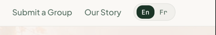

# LanguageToggle

Links between the English and French versions of a page: a segmented En / Fr pill for the header, or a labelled list for the footer. Renders a `<nav>` of router-aware [`Link`](../../src/components/LinkProvider/)s.

**Status:** complete

## When to use

- `segmented` in the [`SiteHeader`](./site-header.md) actions slot.
- `list` in the [`SiteFooter`](./site-footer.md) extra slot.
- It's presentational: it takes the hrefs, so it works with whichever bilingual routing the site adopts.

## Used in

Site header and footer on every page.



## Import

```tsx
import { LanguageToggle } from '@/components/LanguageToggle';
```

## Basic usage

```tsx
const languages = [
  { code: 'en', label: 'English', shortLabel: 'En', href: '/', isCurrent: true },
  { code: 'fr', label: 'Français', shortLabel: 'Fr', href: '/fr' },
];

<SiteHeader navItems={navItems}>
  <LanguageToggle languages={languages} />
</SiteHeader>

<SiteFooter name="WP Canada">
  <LanguageToggle languages={languages} variant="list" navLabel="Footer language" />
</SiteFooter>
```

## Props

| Prop | Type | Default | Description |
|---|---|---|---|
| `languages` | `{ code, label, shortLabel?, href, isCurrent? }[]` | — | One entry per language |
| `variant` | `'segmented' \| 'list'` | `'segmented'` | Header pill or footer list |
| `label` | `string` | `'Language'` | The nav's accessible name and the list's visible label |
| `navLabel` | `string` | `label` | The nav's accessible name, when it should differ from the visible label. Set it on one of two toggles on the same page |
| `className` | `string` | — | Extra classes |

## CSS classes

| Class | When applied |
|---|---|
| `wpc-language-toggle`, `wpc-language-toggle--{variant}` | Always |
| `wpc-language-toggle__label` | `list` only |
| `wpc-language-toggle__list`, `__link` | Always |
| `wpc-language-toggle__link--current` | The current language |

## Design tokens

| Token | Used for |
|---|---|
| `--wpc--color-stone`, `--wpc--color-canvas` (mixed 50/50) | Segmented pill fill |
| `--wpc--color-border` (role), `--wpc--radius-full` | Pill border and shape |
| `--wpc--color-forest-light`, `--wpc--color-white` | Current segment |
| `--wpc--color-text`, `--wpc--color-text-muted` (roles) | Links (and the list's current / other links) |
| `--wpc--font-family-mono`, `--wpc--font-size-x-small`, `--wpc--font-weight-medium`, `--wpc--line-height-snug` | Segment labels |
| `--wpc--spacing-2x-small`, `--wpc--spacing-x-small` | Padding and gaps |
| `--wpc--transition-fast` | Colour transitions |

## Accessibility

- A `<nav aria-label="Language">`, so it's a navigation landmark distinct from the primary and footer navs.
- The site renders two toggles, in the header and the footer. The footer one passes `navLabel` ("Footer language" / "Langue du pied de page") so the two landmarks have different names; the visible label stays "Language".
- Each link has `hrefLang` and `lang`, so screen readers pronounce "Français" in French.
- Segmented links show "En" / "Fr" but hide them from screen readers and expose the full name ("English", "Français") instead.
- The current language has `aria-current="true"`, and the filled segment doesn't rely on colour alone (fill plus text colour).
