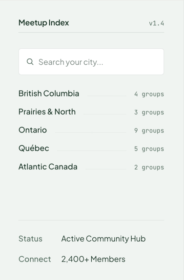

# MeetupIndex

The hero's sidebar panel: a title and version, a search slot, a list of regions with group counts, and a few facts at the bottom. Renders a labelled `<section>`.

**Status:** complete

## When to use

- In the [`Hero`](./hero.md) `aside`, on the homepage.
- The `search` slot takes a [`SearchField`](./search-field.md) that a client wrapper controls (the same pattern as [`FilterBar`](./filter-bar.md)).

## Used in

Homepage hero.



## Import

```tsx
import { MeetupIndex } from '@/components/MeetupIndex';
```

## Basic usage

```tsx
<MeetupIndex
  version="v1.4"
  search={<SearchField label="Search groups by city" placeholder="Search your city..." />}
  regions={[
    { label: 'British Columbia', count: 4, href: '#bc' },
    { label: 'Ontario', count: 9, href: '#on' },
  ]}
  meta={[
    { label: 'Status', value: 'Active Community Hub' },
    { label: 'Connect', value: '2,400+ Members' },
  ]}
/>
```

## Props

| Prop | Type | Default | Description |
|---|---|---|---|
| `title` | `string` | `'Meetup Index'` | Panel title and the section's accessible name |
| `version` | `string` | — | Muted mono tag beside the title |
| `search` | `ReactNode` | — | Slot below the title |
| `regions` | `{ label, count, href? }[]` | — | Region rows; links when `href` is set. A fragment (`#region-bc`) renders a plain `<a>` so the browser fires `hashchange`, which `next/link` doesn't |
| `countLabel` | `(count: number) => string` | "1 group" / "n groups" | Formats each count; the homepage passes a localized plural |
| `meta` | `{ label, value }[]` | — | Facts pinned to the bottom |
| `className` | `string` | — | Extra classes |

## CSS classes

| Class | When applied |
|---|---|
| `wpc-meetup-index` | Always |
| `wpc-meetup-index__header`, `__title` | Title row |
| `wpc-meetup-index__regions`, `__region`, `__name`, `__leader`, `__count` | Region rows |
| `wpc-meetup-index__meta`, `__meta-row` | `meta` is set |

## Design tokens

| Token | Used for |
|---|---|
| `--wpc--font-family-sans`, `--wpc--font-size-large`, `--wpc--font-weight-semibold` | Title and region names |
| `--wpc--font-family-mono`, `--wpc--font-size-x-small` | Counts |
| `--wpc--color-heading`, `--wpc--color-text`, `--wpc--color-text-muted`, `--wpc--color-accent`, `--wpc--color-border` (roles) | Names, values, muted text, link hover, rules and the dotted leader |
| `--wpc--spacing-x-small` … `--wpc--spacing-medium` | Gaps and padding |
| `--wpc--transition-fast` | Name hover |

## Responsive behaviour

The panel fills the height it's given; the meta block sits at the bottom (`margin-top: auto`).

## Accessibility

- A `<section aria-label="Meetup Index">`. The title is a paragraph rather than a heading, so the hero's h1 stays the first heading on the page.
- Counts read naturally ("British Columbia 4 groups"; singular for one). Pass `countLabel` to translate them. The dotted leader is `aria-hidden`.
- The meta facts are a `<dl>`.
