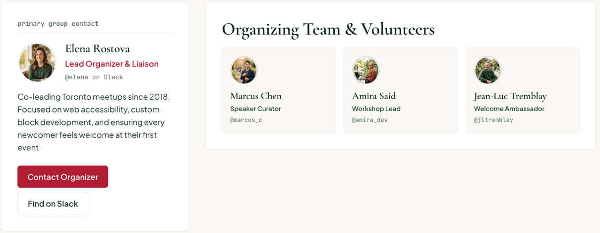

# PersonCard

A person on a group's team: avatar, name, role, Slack handle, and for the primary contact a bio and actions. Renders a [`Card`](./card.md) as an `<article>`.

**Status:** complete

## When to use

- `featured`: the primary group contact, with a label, bio and buttons.
- `compact`: organizers and volunteers in a grid.

## Used in

Group page primary contact and "Organizing Team & Volunteers".



## Import

```tsx
import { PersonCard } from '@/components/PersonCard';
```

## Basic usage

```tsx
<PersonCard
  label="primary group contact"
  name="Elena Rostova"
  role="Lead Organizer & Liaison"
  handle="@elena on Slack"
  avatarSrc="/people/elena.jpg"
  bio={<p>Co-leading Toronto meetups since 2018…</p>}
  actions={
    <>
      <Button text="Contact Organizer" href="/contact" />
      <Button text="Find on Slack" color="secondary" href="/slack" />
    </>
  }
/>

<PersonCard variant="compact" name="Marcus Chen" role="Speaker Curator" handle="@marcus_c" />
```

## Props

| Prop | Type | Default | Description |
|---|---|---|---|
| `name` | `string` | — | Name (also the avatar initials) |
| `role` | `string` | — | Role line |
| `handle` | `string` | — | Mono handle line |
| `avatarSrc` | `string` | — | Photo; initials show without it |
| `bio` | `ReactNode` | — | Featured only |
| `label` | `string` | — | Featured only: eyebrow over a rule |
| `actions` | `ReactNode` | — | Featured only: stacked buttons |
| `variant` | `'featured' \| 'compact'` | `'featured'` | Layout |
| `headingLevel` | `2 \| 3 \| 4` | `3` | Name element |

## CSS classes

| Class | When applied |
|---|---|
| `wpc-person-card`, `wpc-person-card--{variant}` | Always (on the Card root) |
| `wpc-person-card__label`, `__header`, `__identity`, `__role`, `__bio`, `__actions` | Parts |

## Design tokens

| Token | Used for |
|---|---|
| `--wpc--color-accent` (role) | Featured role |
| `--wpc--color-moss` | Compact role |
| `--wpc--color-border` (role) | Label rule |
| `--wpc--font-family-sans`, `--wpc--font-weight-medium`, `--wpc--font-size-medium`, `--wpc--font-size-small` | Role line |
| `--wpc--spacing-2x-small` … `--wpc--spacing-small` | Gaps |

Featured is a white Card with a shadow and `medium` padding; compact is a canvas Card with `small` padding.

## Accessibility

- An `<article>` with the name as its heading.
- The [`Avatar`](./avatar.md) is decorative, since the name is right beside it.
- Buttons in `actions` should name their destination; several "Contact" buttons on one page need distinct labels.
