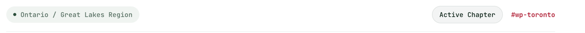
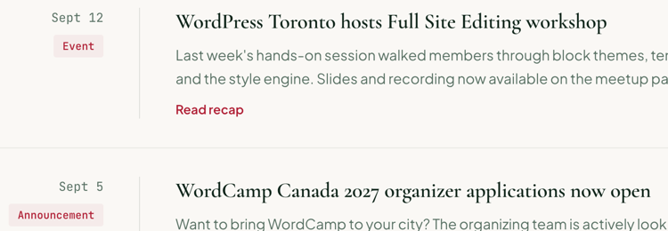

# Pill

A small mono badge in three styles: an update **tag**, a **region** label with a dot, and a **status** chip. Renders a `<span>` by default.

**Status:** complete

## When to use

- `tag`: an update's category (Event, Announcement, Resource, Community).
- `region`: where a group is ("Ontario / Great Lakes Region").
- `status`: a group's state ("Active Chapter").
- Not interactive. For selectable filters use [`FilterPill`](./filter-pill.md).

## Used in

Community updates (tags), group page header (region and status).





## Import

```tsx
import { Pill } from '@/components/Pill';
```

## Basic usage

```tsx
<Pill>Event</Pill>
<Pill variant="region">Ontario / Great Lakes Region</Pill>
<Pill variant="status">Active Chapter</Pill>
```

## Props

| Prop | Type | Default | Description |
|---|---|---|---|
| `children` | `ReactNode` | — | Label |
| `variant` | `'tag' \| 'region' \| 'status'` | `'tag'` | Style |
| `as` | `'span' \| 'li'` | `'span'` | Element; use `li` inside a list |

Other HTML attributes pass through.

## CSS classes

| Class | When applied |
|---|---|
| `wpc-pill` | Always |
| `wpc-pill--{variant}` | Always |

## Design tokens

| Token | Used for |
|---|---|
| `--wpc--font-family-mono`, `--wpc--font-size-x-small`, `--wpc--font-weight-normal`, `--wpc--line-height-tight`, `--wpc--line-height-snug` | Typography |
| `--wpc--color-crimson-100`, `--wpc--color-accent` (role), `--wpc--radius-sm` | Tag |
| The sage surface (`--wpc-surface-fill`), `--wpc--color-text-muted` (role), `--wpc--color-forest-800`, `--wpc--radius-full` | Region and its dot |
| The sage surface (`--wpc-surface-fill`, `--wpc-surface-border`), `--wpc--color-heading` (role) | Status |
| `--wpc--spacing-2x-small`, `--wpc--spacing-x-small`, `--wpc--spacing-small` | Padding and dot gap |

The region dot is `0.4em` and the status pill takes 1px off its block padding to make room for its border; both are relative or structural values.

## Accessibility

- A plain `<span>` with no role: screen readers read the text inline. The dot is a pseudo-element and isn't announced.
- The colours are decoration; the label text carries the meaning.
- Tag text is `crimson-600` on `crimson-100`, about 5.8:1. Pills are designed for light surfaces; inside an inverse section the tag's accent text becomes the light accent and loses contrast on the tint.
