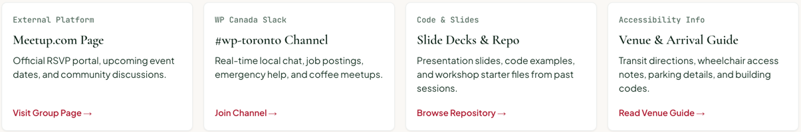

# ResourceCard

A link to a group resource: label, title, description and an arrow link pinned to the bottom. Renders a white [`Card`](./card.md) as an `<article>`.

**Status:** complete

## When to use

- A row of chapter resources (Meetup page, Slack channel, slides, venue guide), in a [`GridGroup`](./grid-group.md) with `columns={4}`.

## Used in

Group page "Local Resources & Chapter Links".



## Import

```tsx
import { ResourceCard } from '@/components/ResourceCard';
```

## Basic usage

```tsx
<GridGroup columns={4} gap="small">
  <ResourceCard
    label="External Platform"
    title="Meetup.com Page"
    description="Official RSVP portal, upcoming event dates, and community discussions."
    href="https://meetup.com/wptoronto"
    linkText="Visit Group Page"
  />
</GridGroup>
```

## Props

| Prop | Type | Default | Description |
|---|---|---|---|
| `label` | `string` | — | Muted eyebrow |
| `title` | `string` | — | Heading text |
| `description` | `string` | — | Short paragraph |
| `href` | `string` | — | Link destination |
| `linkText` | `string` | — | Link text |
| `headingLevel` | `2 \| 3 \| 4` | `3` | Title element |

## CSS classes

| Class | When applied |
|---|---|
| `wpc-resource-card` | Always (on the Card root) |
| `wpc-resource-card__description`, `__link` | Description, link |

## Design tokens

| Token | Used for |
|---|---|
| `--wpc--font-size-small` | Description |
| `--wpc--spacing-x-small`, `--wpc--spacing-small` | Gaps and link spacing |

The Card supplies the surface, border, shadow and `medium` padding.

## Responsive behaviour

The card fills its grid cell, so cards in a row share a height and their links line up at the bottom.

## Accessibility

- An `<article>` with a heading. Link texts differ per card, so they need no extra label.
- The arrow is decorative.
