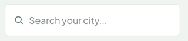

# SearchField

A search input with a leading search icon and a visually hidden label. A [`TextField`](./text-field.md) preset, slightly taller than standard fields.

**Status:** complete

## When to use

- Filtering a list as people type, such as the Meetup Index's "Search your city…".
- Controlled: the parent owns `value` and filters its own results (see [`FilterBar`](./filter-bar.md) for the pattern).

## Used in

Homepage hero Meetup Index.



## Import

```tsx
import { SearchField } from '@/components/SearchField';
```

## Basic usage

```tsx
const [query, setQuery] = useState('');

<SearchField
  label="Search groups by city"
  placeholder="Search your city..."
  value={query}
  onChange={(event) => setQuery(event.target.value)}
/>
```

## Props

| Prop | Type | Default | Description |
|---|---|---|---|
| `label` | `string` | `'Search'` | Screen-reader label |

Other `<input>` props pass through (`value`, `onChange`, `placeholder`…).

## CSS classes

| Class | When applied |
|---|---|
| `wpc-search-field` | Always, alongside the TextField classes |

## Design tokens

TextField's tokens, with `--wpc--spacing-small` block padding and `--wpc--line-height-snug` (about 55px tall).

## Accessibility

- The label is visually hidden but stays the accessible name; make it descriptive ("Search groups by city"), not just "Search".
- `type="search"` gives screen readers the search role and a clear button.
- Announce result counts in a live region next to the results, not on the field.
