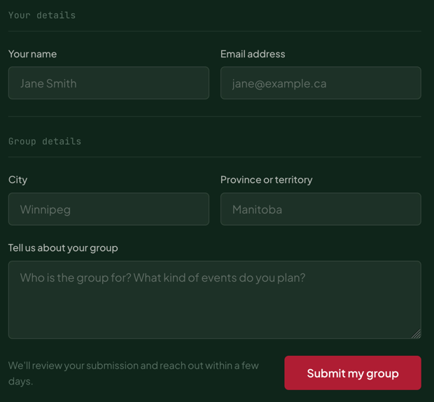

# Select

A labelled native `<select>` styled like the other fields, with a chevron icon in place of the browser arrow.

**Status:** complete

## When to use

- Choosing one option from a fixed list, such as province or territory.
- For a handful of options shown at once, prefer radio buttons; for filters, [`FilterBar`](./filter-bar.md).

## Used in

"Start a group" form (province or territory).



## Import

```tsx
import { Select } from '@/components/Select';
```

## Basic usage

```tsx
<Select
  label="Province or territory"
  name="province"
  options={[{ value: 'MB', label: 'Manitoba' }]}
  placeholder="Choose one"
  defaultValue=""
  required
/>
```

## Props

| Prop | Type | Default | Description |
|---|---|---|---|
| `label` | `string` | — | Visible label (required) |
| `options` | `{ value: string; label: string }[]` | — | Choices |
| `placeholder` | `string` | — | Adds an empty first option |
| `hideLabel` | `boolean` | `false` | Keeps the label for screen readers only |
| `error` | `string` | — | Message shown under the field; sets `aria-invalid` and links the message with `aria-describedby` |

Other `<select>` props pass through.

## CSS classes

| Class | When applied |
|---|---|
| `wpc-select` | Always (the wrapper `<div>`) |
| `wpc-select__field` | The `<label>` around the label text and control |
| `wpc-select__error` | `error` is set |
| `wpc-select__label`, `__control`, `__input`, `__icon` | Parts |

## Design tokens

The same field roles, `control` mixin and error styles as [`TextField`](./text-field.md), plus extra inline-end padding for the chevron.

## Accessibility

- A native select: full keyboard support and the platform's own picker on mobile.
- With `placeholder` and `required`, the empty first option makes the browser ask for a real choice.
- `error` works as in [`TextField`](./text-field.md): `aria-invalid` plus a message linked with `aria-describedby`.
- The chevron is decorative. Inverse sections set `color-scheme: dark` so the options menu renders dark.
