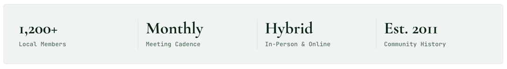

# StatGroup

A row of label-and-value statistics. Renders a description list (`<dl>`), with `StatGroup.Item` for each stat.

**Status:** complete

## When to use

- `serif`: headline facts about a group (members, cadence, format, history), usually inside a tint [`Card`](./card.md).
- `mono`: small counts, such as the footer of the Slack [`ChatPreview`](./chat-preview.md).

## Used in

Group page header stats panel, Slack preview footer.



## Import

```tsx
import { StatGroup } from '@/components/StatGroup';
```

## Basic usage

```tsx
<Card backgroundColor="tint" borderRadius="md">
  <StatGroup>
    <StatGroup.Item value="1,200+" label="Local Members" />
    <StatGroup.Item value="Monthly" label="Meeting Cadence" />
  </StatGroup>
</Card>

<StatGroup variant="mono">
  <StatGroup.Item value="2,400+" label="members" />
</StatGroup>
```

## Props

| Prop | Type | Default | Description |
|---|---|---|---|
| `children` | `ReactNode` | — | `StatGroup.Item` elements |
| `variant` | `'serif' \| 'mono'` | `'serif'` | Style |

`StatGroup.Item` takes `value: ReactNode` and `label: string`.

## CSS classes

| Class | When applied |
|---|---|
| `wpc-stat-group`, `wpc-stat-group--{variant}` | Always |
| `wpc-stat-group__item`, `__label`, `__value` | Each stat |

## Design tokens

| Token | Used for |
|---|---|
| `--wpc--font-family-serif`, `--wpc--font-size-heading-medium`, `--wpc--font-weight-medium`, `--wpc--line-height-tight` | Serif values |
| `--wpc--font-family-mono`, `--wpc--font-size-x-small` | Serif labels |
| `--wpc--font-family-mono`, `--wpc--font-size-medium`, `--wpc--line-height-snug` | Mono values |
| `--wpc--font-family-sans`, `--wpc--font-size-small` | Mono labels |
| `--wpc--color-heading`, `--wpc--color-text-muted`, `--wpc--color-border` (roles) | Values, labels, dividers |
| `--wpc--spacing-2x-small` … `--wpc--spacing-large` | Gaps and divider padding |

## Responsive behaviour

`serif` is two by two on small screens and one row with dividers above the tablet breakpoint. `mono` wraps.

## Accessibility

- A `<dl>`: each label is a `<dt>` and comes before its value in the DOM, so screen readers hear "Local Members, 1,200+". CSS shows the value first.
