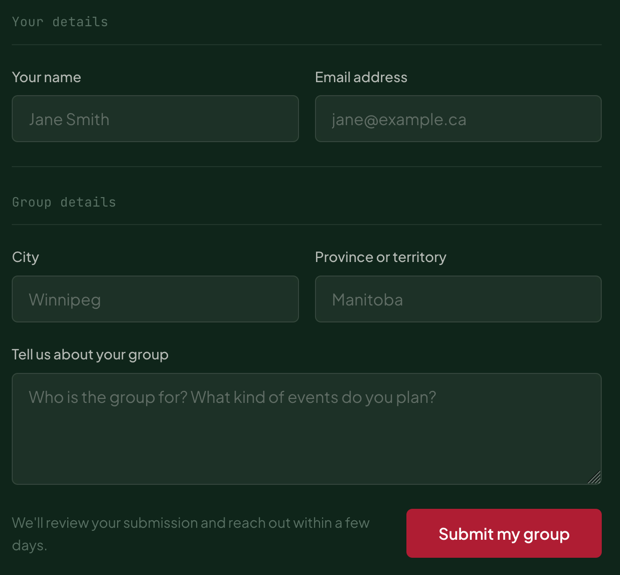

# TextArea

A labelled multi-line input. The `<label>` wraps the `<textarea>`.

**Status:** complete

## When to use

- Free text longer than a line: "Tell us about your group".

## Used in

"Start a group" form.



## Import

```tsx
import { TextArea } from '@/components/TextArea';
```

## Basic usage

```tsx
<TextArea
  label="Tell us about your group"
  name="about"
  placeholder="Who is the group for? What kind of events do you plan?"
/>
```

## Props

| Prop | Type | Default | Description |
|---|---|---|---|
| `label` | `string` | — | Visible label (required) |
| `hideLabel` | `boolean` | `false` | Keeps the label for screen readers only |
| `rows` | `number` | `4` | Initial height |

Other `<textarea>` props pass through.

## CSS classes

| Class | When applied |
|---|---|
| `wpc-text-area` | Always (the `<label>`) |
| `wpc-text-area__label`, `__input` | Parts |

## Design tokens

The same field roles and `control` mixin as [`TextField`](./text-field.md); the textarea resizes vertically only.

## Accessibility

- Named by its wrapping label. The global focus ring applies.
