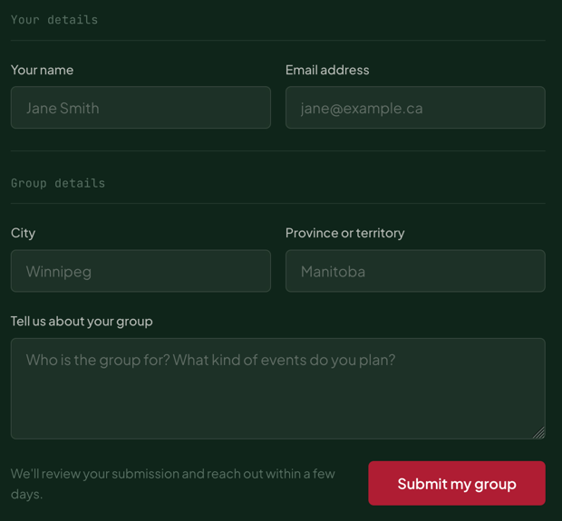

# TextField

A labelled single-line input, with an optional leading icon. The `<label>` wraps the `<input>`, so they're associated without ids.

**Status:** complete

## When to use

- Short text: name, email, city, phone, URL.
- [`SearchField`](./search-field.md) for search, [`TextArea`](./text-area.md) for longer text, [`Select`](./select.md) for a fixed list.

## Used in

"Start a group" form (name, email, city).



## Import

```tsx
import { TextField } from '@/components/TextField';
```

## Basic usage

```tsx
<TextField label="Your name" name="name" placeholder="Jane Smith" autoComplete="name" required />
<TextField label="Email address" name="email" type="email" autoComplete="email" />
```

## Props

| Prop | Type | Default | Description |
|---|---|---|---|
| `label` | `string` | — | Visible label (required) |
| `hideLabel` | `boolean` | `false` | Keeps the label for screen readers only |
| `icon` | `IconName` | — | Leading icon |
| `type` | `'text' \| 'email' \| 'tel' \| 'url' \| 'search'` | `'text'` | Input type |

Other `<input>` props (`name`, `value`, `onChange`, `required`, `autoComplete`…) pass through; `className` goes on the label wrapper.

## CSS classes

| Class | When applied |
|---|---|
| `wpc-text-field` | Always (the `<label>`) |
| `wpc-text-field--has-icon` | `icon` is set |
| `wpc-text-field__label`, `__control`, `__input`, `__icon` | Parts |

## Design tokens

The control look comes from the shared `control` mixin (`src/styles/mixins/_field.scss`):

| Token | Used for |
|---|---|
| `--wpc--color-field`, `--wpc--color-field-border` (roles) | Background and border: white with a stone or sage-dark border on light; forest-light with a pine border on inverse |
| `--wpc--color-text`, `--wpc--color-text-muted` (roles) | Text and placeholder |
| `--wpc--font-family-sans`, `--wpc--font-size-medium`, `--wpc--line-height-relaxed` | Input text (about 44px tall) |
| `--wpc--font-size-small` | Label |
| `--wpc--spacing-x-small`, `--wpc--spacing-small`, `--wpc--radius-sm` | Padding and corners |

## Accessibility

- The wrapping label names the input, including when `hideLabel` is used (the text stays in the accessible name).
- Don't rely on the placeholder as a label: it disappears on typing and is low contrast by design.
- Focus shows the global ring (crimson on light, the light accent on inverse).
- Inverse sections set `color-scheme: dark`, so native parts such as the search clear button render to match.
