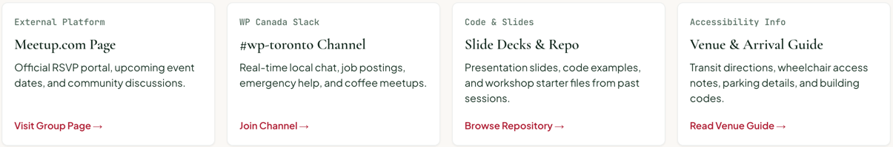

# TextLink

A standalone call-to-action link: crimson and semibold, with an optional trailing arrow, or in mono for channel names. Renders a router-aware [`Link`](../../src/components/LinkProvider/).

**Status:** complete

## When to use

- A link that stands on its own line or at the end of a card: "View group details", "Browse groups", "Read recap", "View all groups".
- `hasArrow` for resource-style links: "Visit Group Page →".
- `font="mono"` for channel or handle links such as "#wp-toronto".
- Links inside running text stay plain `<a>` elements (styled by [`Main`](./main.md)); buttons use [`Button`](./button.md).

## Used in

Group cards, feature items, update items, resource cards, the "View all groups" row, the group header's Slack channel.



## Import

```tsx
import { TextLink } from '@/components/TextLink';
```

## Basic usage

```tsx
<TextLink href="/groups/toronto">View group details</TextLink>

<TextLink href="https://meetup.com/wptoronto" size="small" hasArrow>
  Visit Group Page
</TextLink>

<TextLink href="/slack" font="mono" size="small">#wp-toronto</TextLink>
```

## Props

| Prop | Type | Default | Description |
|---|---|---|---|
| `href` | `string` | — | Destination (required) |
| `children` | `ReactNode` | — | Link text |
| `hasArrow` | `boolean` | `false` | Trailing arrow icon |
| `font` | `'sans' \| 'mono'` | `'sans'` | Typeface |
| `size` | `'small' \| 'medium'` | `'medium'` | Font size |

Other `<a>` props pass through.

## CSS classes

| Class | When applied |
|---|---|
| `wpc-text-link` | Always |
| `wpc-text-link--{font}`, `wpc-text-link--{size}` | Always |
| `wpc-text-link__arrow` | `hasArrow` |

## Design tokens

| Token | Used for |
|---|---|
| `--wpc--color-accent` (role) | Colour: crimson on light, the light accent on inverse |
| `--wpc--font-family-sans`, `--wpc--font-weight-semibold` | Sans variant |
| `--wpc--font-family-mono`, `--wpc--font-weight-medium` | Mono variant |
| `--wpc--font-size-small`, `--wpc--font-size-medium` | Sizes |
| `--wpc--spacing-2x-small` | Arrow gap and hover nudge |
| `--wpc--transition-fast` | Arrow nudge |

The underline offset is `0.2em`, a relative value.

## Accessibility

- Underlined on hover and keyboard focus, and the global focus ring applies, so focus doesn't rely on colour.
- The arrow is decorative (`aria-hidden`); the text must say where the link goes. Several "View group details" links on one page need distinct names: add an `aria-label` that starts with the visible text, or `aria-describedby` pointing at the card title.
- The arrow's hover nudge is turned off under `prefers-reduced-motion`.
- Crimson on canvas is about 6.5:1.
