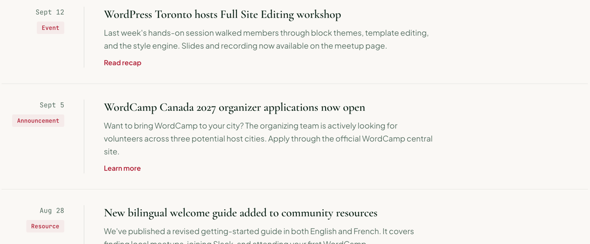

# UpdateList

A list of community updates: date and category on one side of a vertical rule, title, excerpt and link on the other. Renders a `<ul>`, with `UpdateList.Item` for each update.

**Status:** complete

## When to use

- News and announcements in date order: events, announcements, resources, community milestones.

## Used in

Homepage "Community updates".



## Import

```tsx
import { UpdateList } from '@/components/UpdateList';
```

## Basic usage

```tsx
<UpdateList>
  <UpdateList.Item
    date="Sept 12"
    dateTime="2026-09-12"
    category="Event"
    title="WordPress Toronto hosts Full Site Editing workshop"
    excerpt="Last week's hands-on session walked members through block themes…"
    href="/updates/fse-workshop"
    linkText="Read recap"
  />
</UpdateList>
```

## Props

`UpdateList` takes `children` plus `<ul>` attributes.

`UpdateList.Item`:

| Prop | Type | Default | Description |
|---|---|---|---|
| `date` | `string` | — | Display date ("Sept 12") |
| `dateTime` | `string` | — | Machine date for `<time>` |
| `category` | `string` | — | Tag [`Pill`](./pill.md) |
| `title` | `string` | — | Heading text |
| `excerpt` | `ReactNode` | — | Muted summary |
| `href` | `string` | — | Link destination |
| `linkText` | `string` | — | Link text |
| `headingLevel` | `2 \| 3 \| 4` | `3` | Title element |

## CSS classes

| Class | When applied |
|---|---|
| `wpc-update-list` | The list |
| `wpc-update-list__item`, `__meta`, `__content`, `__excerpt` | Each update |

## Design tokens

| Token | Used for |
|---|---|
| `--wpc--color-border` (role) | Item rules and the vertical rule |
| `--wpc--color-text-muted` (role) | Excerpt |
| `--wpc--layout-small-size` | Excerpt max width |
| `--wpc--spacing-x-small` … `--wpc--spacing-large` | Gaps and padding |

## Responsive behaviour

Above the mobile breakpoint the list is a two-column grid and each item a `subgrid` row, so the date-and-tag column takes the width of its widest entry and lines up across every update. Below it, items stack, with the date and tag inline and no vertical rule.

## Accessibility

- A list (`role="list"` restores the semantics Safari drops with `list-style: none`), so screen readers announce the number of updates.
- Dates use `<time datetime>`.
- Links get `aria-label="{linkText}, {title}"` so repeated texts such as "Read recap" stay distinct.
